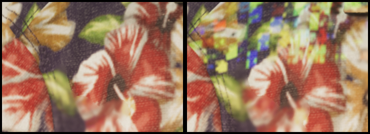

# A study on "clown vomit": how to use dive to catch a picture fault that only shows sometimes

"Clown vomit" is a user-coined term for page-sized rainbow squares on a character's clothes. You see them for a few
seconds in a cutscene, on one card but not the other, and not every time. This page shows how we tracked it down
with dive's captures in ten short runs, what we found, and what we got wrong along the way.

*Left: RTX 5070 Ti, clean. Right: RTX 5090, the same moment of the same cutscene. Squares of other data cover
the shirt's pattern, and the right pattern still shows through between them.*

## 1. Make the shot repeatable

A fault that shows "somewhere in a cutscene" can't be compared between runs. Pin it to a time instead:

    VICTORY_CAPTURE=<folder> VICTORY_CAPTURE_FULL=1 VICTORY_CAPTURE_RAW=1 \
    VICTORY_CAPTURE_SCENE=0x048647ec:20-80

This saves every frame from 20 to 80 seconds after each start of the boat cutscene (`0x048647ec`), at full
size, as raw rows (fast to save). Cutscenes keep to the wall clock, so "34 seconds in" is the same shot in every
run, even though the frame numbers differ. We picked two moments, about 31 and 51 seconds in, and cut the same
collar region from each run: one matched pair per run.

Run every attempt from a fresh **copy** of the same save, with its own prefix and caches, and one game per card.
Two games on one card at once spoil both runs' timing (we lost one run that way).

## 2. One change per run, and a control

| run | card | change | collar |
|---|---|---|---|
| cv2 | 5070 Ti | none | clean |
| cv4 | 5090 | none | **noisy** |
| cv5 | 5090 | decoration bake allowed 10 s | clean |
| cv6 | 5090 | `VICTORY_HEAP_RECHECK=1` | clean |
| cv7 | 5090 | a suspected shader fix, cold shader cache | clean |
| cv8 | 5090 | **control**: none, but the same extra logging and key presses as cv5–cv7 | **noisy**, worse |
| cv9 | 5090 | the same shader fix switched **off**, cold cache | clean |
| cv10 | 5090 | `VICTORY_HEAP_RECHECK=1` again | clean |

Two lessons are in that table:

- **The control run matters.** cv5 and cv6 changed more than the one switch: extra logging, and a held key
  that skipped part of the scene before. cv8 had only those extras and was still noisy, so the extras were not
  the cure.
- **A cold cache is a change too.** cv7 looked like proof that our shader fix worked. cv9 ran the same build
  with the fix switched off and was just as clean. Both started with a cold shader cache, so the cutscene came
  almost two minutes later than in the other runs. The timing hid the fault, not the fix. Our first hypothesis
  was wrong, and only the off-switch run showed it.

## 3. Read what the logs say differently

At the same shot the 5070 Ti logged that textures picked by index had to wait because the card had no room.
The 5090 had room and uploaded them early. Our speed settings also turn off the re-check of such textures after
upload (`VICTORY_HEAP_RECHECK=0`). Put together: a texture uploaded while the title is still streaming its
pages keeps the missing pages' old bytes for the rest of the run. The result is page-sized squares of other
data, with the right texture showing through around them, which is what the pictures show.

## 4. What we have, and what we don't

- **Cause, as far as we can tell:** early uploads of textures that are still streaming in, with no re-check
  afterwards. It shows on the card with more room (here the RTX 5090).
- **Switch:** `VICTORY_HEAP_RECHECK=1` cleared it in 2 of 2 runs. It is **not** a default yet: in one longer
  play test with it on, a wall in another scene got a dark blocky smudge that the run without it didn't have.
  One against one isn't enough to say more, but it means the switch is too broad.
- **Next:** a narrow fix that re-checks only textures uploaded while their pages were still streaming.
- **Cost:** the captures didn't measurably change the frame rate of the diagnostics build.

## Doing this yourself

1. A diagnostics build with dive (`VICTORY_NATIVES=1` for scene starts, `VICTORY_CAPTURE_*` for frames).
2. Find the scene: `scene list` on the channel, or the scene-start lines in the log.
3. Capture a window after its start, pick two moments, crop the same region from every run.
4. Change one thing per run. Run a control that has every extra except the change.
5. Watch for timing changes you didn't intend (cold caches, skipped scenes). They can make a fault vanish.
6. Share the frames with a receipt (`tools/capture-receipt.py`) so others can check which files you mean.

*(written with AI assistance)*
